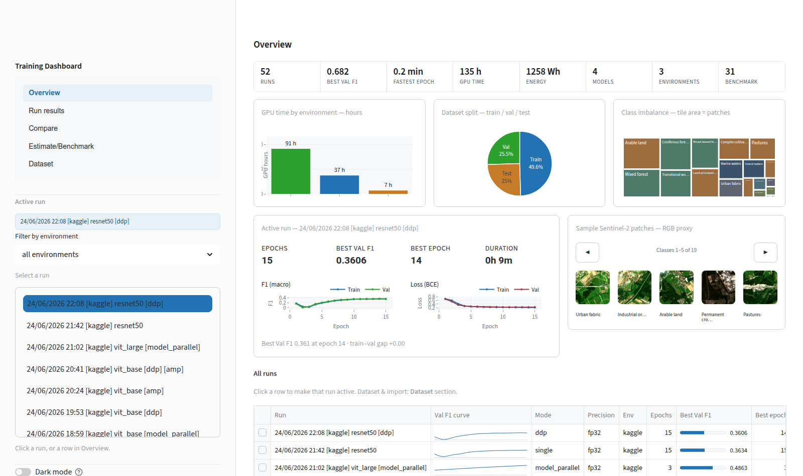

<div align="center">

# Entrenamiento distribuido de modelos abiertos de aprendizaje automático basados en Transformers

### ParaViT-Lab

**Trabajo de Fin de Grado · Grado en Ingeniería Informática · Universidad de La Laguna**

[](https://github.com/alerguezrojas/tfg-distributed-transformers/actions/workflows/ci.yml)


[](https://sonarcloud.io/summary/overall?id=alerguezrojas_tfg-distributed-transformers)
[](https://sonarcloud.io/summary/overall?id=alerguezrojas_tfg-distributed-transformers)
[](https://sonarcloud.io/summary/overall?id=alerguezrojas_tfg-distributed-transformers)
[](https://sonarcloud.io/summary/overall?id=alerguezrojas_tfg-distributed-transformers)

**Autor:** Alejandro Rodríguez Rojas · **Tutor:** Francisco Carmelo Almeida Rodríguez · **Cotutor:** Daniel Suárez Labena

</div>

---

## Descripción

Este Trabajo de Fin de Grado entrena un modelo **Vision Transformer** para la clasificación
multietiqueta de imágenes de satélite Sentinel-2 (**BigEarthNet-S2**, 19 clases de cobertura
terrestre) y analiza, mediante mediciones reales, **cómo escala el entrenamiento al distribuirlo**
entre varias GPU o entre GPU y CPU. Junto al modelo, el proyecto proporciona una **estimación
analítica** que predice tiempo, memoria, energía, coste y calidad *sin necesidad de entrenar*; un
**benchmark** que la contrasta con medidas empíricas en la propia máquina; y un **panel web** para
visualizar y comparar los resultados (incluida una vista que enfrenta, por métrica, la estimación
analítica, el benchmark y el entrenamiento real). Toda la funcionalidad se gobierna desde una única herramienta de línea de
órdenes, **`paravit`**. El sistema desarrollado se denomina **ParaViT-Lab** (*Parallel/Parallax ViT
Lab*); el antiguo comando `tfg` se conserva como alias retrocompatible.

## Resultados principales

- **Calidad del modelo:** ViT-Base preentrenado alcanza un **F1 macro de 0,6816 en validación** y
  **0,6200 en el test oficial** (0,6308 con umbral óptimo) sobre el conjunto completo, usando solo
  las 3 bandas RGB de las 10 disponibles.
- **Estudio controlado de estrategias** (mismo modelo, mismos datos y épocas, 2× Tesla T4):

  | Estrategia | Aceleración | Lectura |
  |---|---|---|
  | Paralelismo de datos (DDP) | **1,99×** | escala casi lineal cuando el cuello es el cómputo |
  | Paralelismo de modelo | 1,06× | no acelera, pero permite entrenar modelos que no entran en una GPU (vit_large) |
  | Precisión mixta (1 GPU) | **3,69×** | los núcleos tensoriales superan a añadir una segunda GPU |
  | DDP + precisión mixta | **5,71×** | se combinan, pero por debajo del producto teórico (7,3×) |
  | GPU + CPU (heterogéneo) | 0,12× | el entrenamiento síncrono avanza al ritmo del dispositivo más lento |

- **Predicción validada:** el estimador analítico predice tiempo, memoria y energía con un error
  inferior al 10 % en el régimen limitado por cómputo, y anticipó los desbordamientos de memoria
  antes de ejecutarlos.

## Calidad del código

El proyecto se acompaña de una batería de **411 pruebas automáticas** ejecutadas en integración
continua y se analiza de forma continua en
[SonarCloud](https://sonarcloud.io/summary/overall?id=alerguezrojas_tfg-distributed-transformers):
calificación **A en mantenibilidad**, **A en fiabilidad** y **A en seguridad**, con un **0,0 % de
código duplicado** sobre ~10 500 líneas (las insignias de la cabecera reflejan el último análisis).

## Requisitos previos

- **git** y **[uv](https://docs.astral.sh/uv/)** (el gestor de paquetes de Python; instala la versión
  de Python necesaria de forma automática).
- Una **GPU NVIDIA** y el **conjunto de datos** únicamente son necesarios para *entrenar*. Para
  explorar el proyecto (panel web, estimación, pruebas) **es suficiente con una CPU**: el repositorio
  ya incluye los resultados reales de los entrenamientos.

## Instalación

```bash
# 1. Instalar uv (Linux/macOS; en Windows PowerShell: irm https://astral.sh/uv/install.ps1 | iex)
curl -LsSf https://astral.sh/uv/install.sh | sh

# 2. Clonar el repositorio e instalar el entorno (uv crea .venv con las dependencias)
git clone https://github.com/alerguezrojas/tfg-distributed-transformers.git
cd tfg-distributed-transformers
uv sync

# 3. Iniciar el menú interactivo
uv run paravit.py menu
```

## Uso: el menú interactivo (`paravit menu`)

Constituye la forma más sencilla de utilizar el proyecto: un menú guiado que solicita los parámetros
de manera secuencial, sin necesidad de memorizar ninguna orden. Desde él es posible:

- **Estimar** de forma analítica una configuración mediante fórmulas, **sin GPU**: tiempo, memoria,
  energía, coste y F1 esperada.
- **Entrenar** con la estrategia deseada: una GPU, varias GPU con DDP, paralelismo de modelo o GPU+CPU.
- **Medir** de forma empírica el rendimiento real de la máquina mediante un *benchmark*.
- **Evaluar** un modelo sobre el conjunto de test.

Para visualizar y comparar los entrenamientos de manera gráfica, ejecútese el **panel web**:

```bash
uv run paravit.py dashboard          # → http://localhost:8501
```



> Para un uso por línea de órdenes, `uv run paravit.py --help` enumera todos los subcomandos. Cada uno
> admite la opción `--dry-run`, que muestra la orden exacta sin llegar a ejecutarla. (`uv run tfg.py`
> sigue funcionando como alias.)

## Documentación

- **[Guía de uso](docs/guia_de_uso.md)** — manual de referencia: comandos, configuraciones,
  estrategias de entrenamiento, artefactos y solución de problemas.
- [Modelo analítico de rendimiento](docs/performance_model.md) — derivación y validación de las
  fórmulas del estimador.
- [Diagrama de clases](docs/class_diagram.svg) — arquitectura completa del sistema.

## Diseño

La arquitectura del ciclo de entrenamiento aplica los principios SOLID y los patrones de diseño
**Decorator** (GoF) y **Template Method**, lo que permite incorporar aspectos transversales (trazado,
métricas, monitorización, medición de energía) sin modificar la lógica del entrenador. El diagrama de
clases completo se encuentra en [`docs/class_diagram.svg`](docs/class_diagram.svg).

## Autoría y licencia

**Alejandro Rodríguez Rojas** — Grado en Ingeniería Informática, Universidad de La Laguna.
Tutor: **Francisco Carmelo Almeida Rodríguez**. Cotutor: **Daniel Suárez Labena**. Curso 2025/2026.

Código distribuido bajo licencia [GNU GPL v3](LICENSE) — copyleft: cualquier versión modificada que
se distribuya debe publicarse también como código abierto bajo GPLv3. © 2026 Alejandro Rodríguez
Rojas. La **memoria** del TFG se distribuye por separado bajo **CC BY-NC-ND 4.0**. El conjunto de
datos BigEarthNet-S2 y los pesos preentrenados conservan sus propias licencias.
