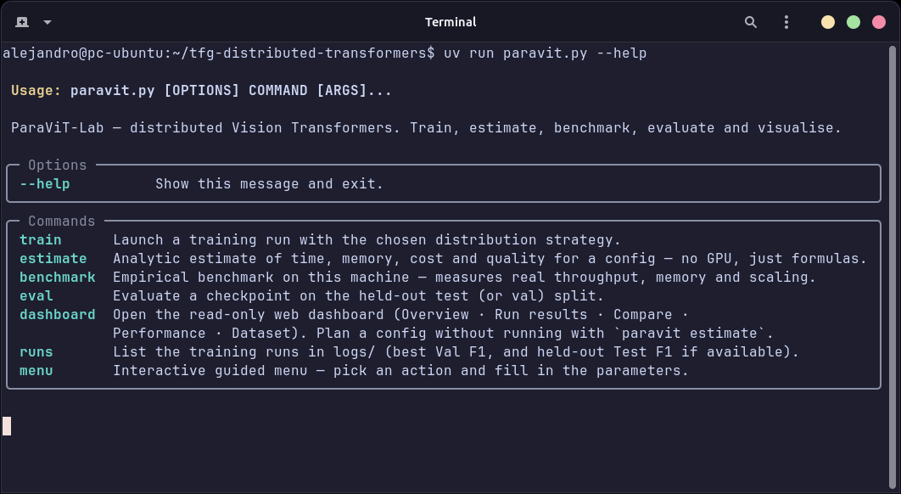
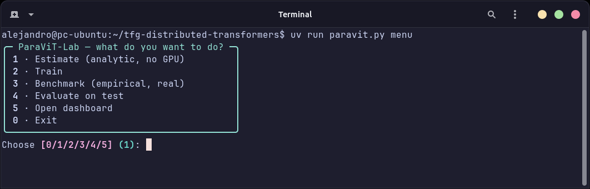
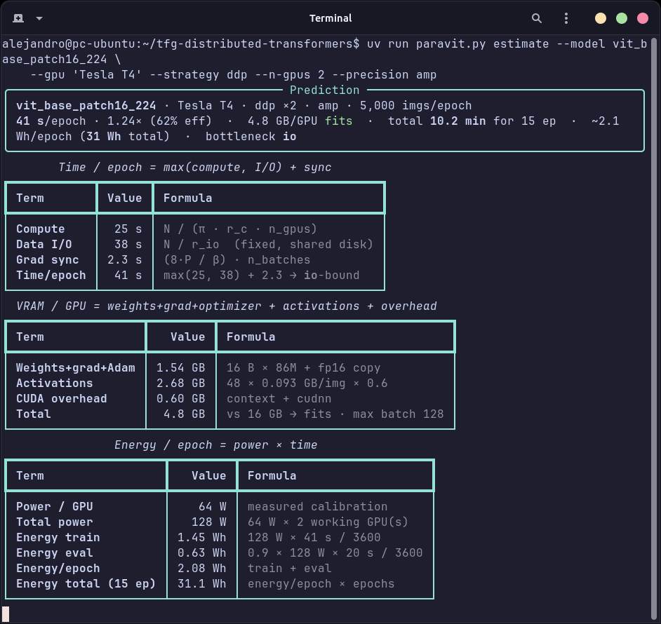
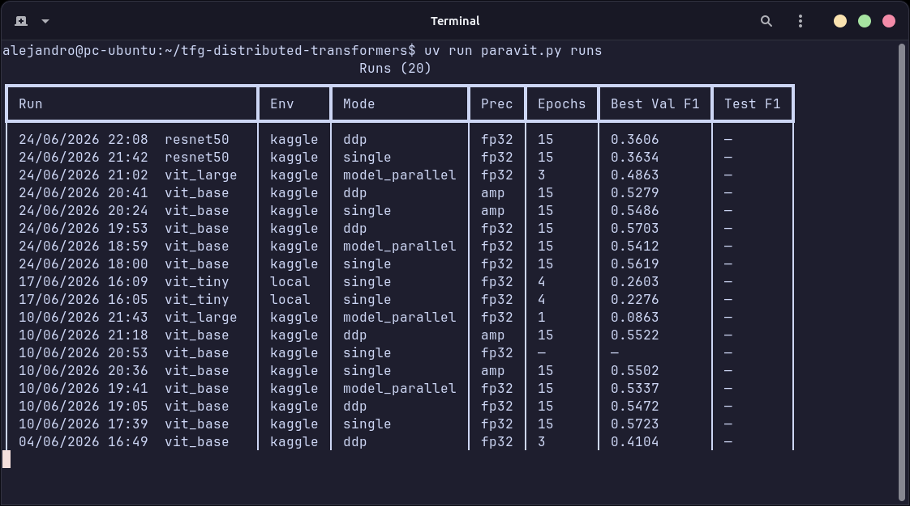
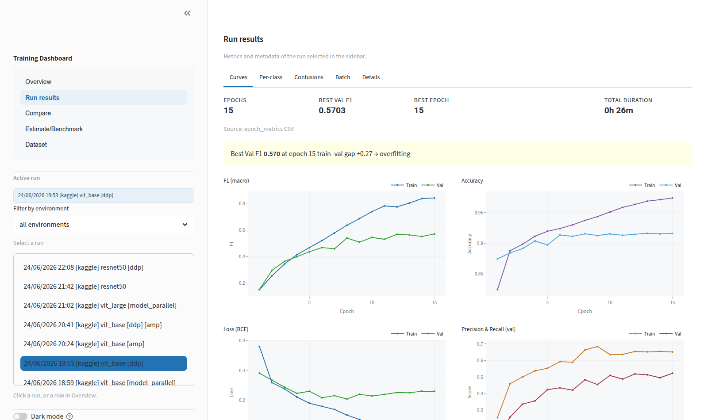
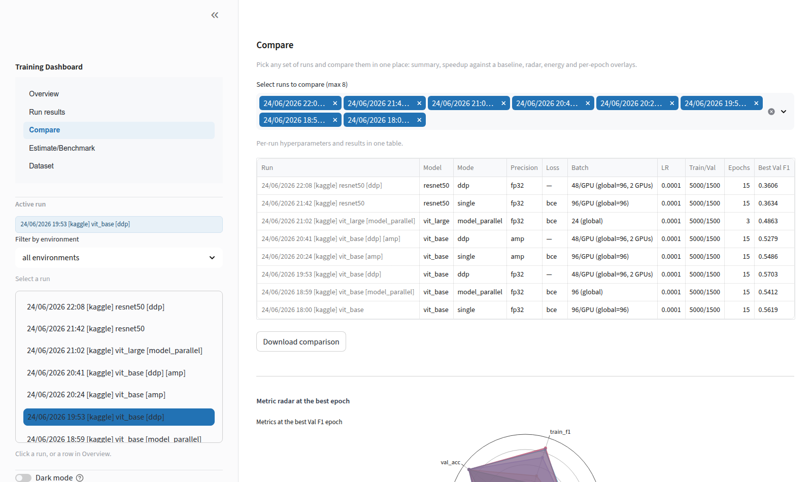
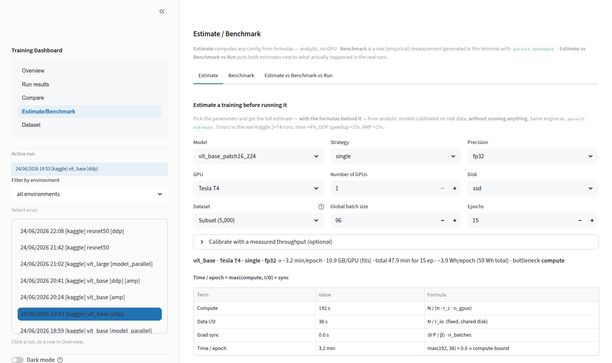

# ParaViT-Lab — Guía de uso

Manual de referencia del sistema por línea de órdenes. Complementa a la guía con capturas de la
memoria del TFG: aquí el foco son los comandos, las configuraciones y la resolución de problemas.

Índice:

1. [Instalación](#1-instalación)
2. [El conjunto de datos (opcional)](#2-el-conjunto-de-datos-opcional)
3. [El CLI `paravit`](#3-el-cli-paravit)
4. [Los ficheros de configuración](#4-los-ficheros-de-configuración)
5. [Las cuatro estrategias de entrenamiento](#5-las-cuatro-estrategias-de-entrenamiento)
6. [Artefactos: qué produce un entrenamiento](#6-artefactos-qué-produce-un-entrenamiento)
7. [El panel web](#7-el-panel-web)
8. [Un flujo de trabajo completo](#8-un-flujo-de-trabajo-completo)
9. [Las pruebas](#9-las-pruebas)
10. [Solución de problemas](#10-solución-de-problemas)

---

## 1. Instalación

Requisitos: `git` y [`uv`](https://docs.astral.sh/uv/) (instala la versión de Python necesaria de
forma automática).

```bash
# Instalar uv si no está presente (Linux/macOS)
curl -LsSf https://astral.sh/uv/install.sh | sh

git clone https://github.com/alerguezrojas/tfg-distributed-transformers.git
cd tfg-distributed-transformers
uv sync
```

No hace falta GPU ni dataset para explorar el proyecto: el estimador analítico calcula con fórmulas
y el panel web lee los resultados reales ya incluidos en `logs/`. La GPU (NVIDIA) solo es necesaria
para entrenar o ejecutar el benchmark, y el dataset solo para entrenar o evaluar.

> **Nota (GPU con driver antiguo):** `uv sync` instala la build de PyTorch más reciente. Si el
> driver de la máquina no la soporta (por ejemplo CUDA 12.0 con driver 525), reinstalar con la
> variante adecuada: `uv pip install torch torchvision --index-url
> https://download.pytorch.org/whl/cu118 --force-reinstall`.

## 2. El conjunto de datos (opcional)

BigEarthNet-S2 v2.0 (549 488 recortes de Sentinel-2, 19 clases multietiqueta) se publica en Zenodo.
Descarga y extracción (63 GB comprimido, ~120 GB extraído; requiere `zstd`):

```bash
wget -c "https://zenodo.org/records/10891137/files/BigEarthNet-S2.tar.zst?download=1" \
     -O BigEarthNet-S2.tar.zst
wget -c "https://zenodo.org/records/10891137/files/metadata.parquet?download=1" \
     -O metadata.parquet
tar --use-compress-program=zstd -xf BigEarthNet-S2.tar.zst
```

Después, apuntar las claves `data.root` (directorio extraído) y `data.metadata` (el
`metadata.parquet`) del fichero de configuración que se vaya a usar.

Para trabajar en plataformas con límite de almacenamiento (Kaggle admite 20 GB por dataset),
`scripts/export_kaggle_subset.py` exporta un subconjunto autocontenido y reproducible (5 000
imágenes de entrenamiento y 1 500 de validación, semilla fija).

## 3. El CLI `paravit`

Punto de entrada único: `uv run paravit.py <comando>` (el antiguo `tfg.py` sigue funcionando como
alias). `--help` funciona en cada subcomando.



| Comando | Qué hace | ¿Necesita GPU? |
|---|---|---|
| `menu` | Menú interactivo: pregunta la acción y los parámetros paso a paso | — |


| `estimate` | Predicción **analítica** de tiempo, memoria, energía, coste y F1 (solo fórmulas) | No |
| `benchmark` | Medición **empírica** en la máquina: throughput real, VRAM, I/O, escalado DDP | Sí |
| `train` | Entrenamiento con la estrategia elegida | Sí |
| `eval` | Evaluación de un checkpoint sobre el split de test (o val) | Sí |
| `runs` | Tabla de todos los entrenamientos registrados con su mejor F1 | No |
| `dashboard` | Abre el panel web en `http://localhost:8501` | No |

### `estimate` — predecir sin entrenar

```bash
uv run paravit.py estimate --model vit_base_patch16_224 --gpu "Tesla T4" \
    --strategy ddp --n-gpus 2 --precision amp
```

Devuelve el titular (s/época, aceleración, VRAM, energía, cuello de botella) y las tablas con las
fórmulas de tiempo `max(cómputo, I/O) + sincronización`, memoria, energía, calidad esperada,
escalado de 1 a 8 GPU y coste en proveedores de nube. Estrategias: `single`, `ddp`,
`model-parallel`, `heterogeneous`. La derivación completa del modelo está en
[`docs/performance_model.md`](performance_model.md).



### `benchmark` — medir la máquina real

```bash
uv run paravit.py benchmark --batch-sizes 32,64 --epochs 15
uv run paravit.py benchmark --model resnet50 --batch-sizes 32,64
```

Usa datos sintéticos (no necesita el dataset) y genera un informe de texto y un CSV en
`logs/<entorno>/benchmark/`, que el panel web muestra en *Estimate/Benchmark → Benchmark*. Con
`--convergence-study` añade un estudio de convergencia con datos reales (requiere el dataset).

### `train` — entrenar

```bash
# Una GPU, config por defecto
uv run paravit.py train --strategy single --config configs/train.yaml

# Con precisión mixta e instrumentación (decoradores)
uv run paravit.py train --strategy single --config configs/train.yaml \
    --precision amp --layers confusion,batch-monitor --fn energy,timing

# Ver el comando final sin ejecutarlo (útil para copiarlo en una máquina remota)
uv run paravit.py train --strategy ddp --config configs/train_demo_ddp.yaml --dry-run
```

Opciones principales:

| Opción | Valores | Efecto |
|---|---|---|
| `--strategy` | `single` · `ddp` · `model-parallel` · `heterogeneous` | Estrategia de distribución; las distribuidas se lanzan solas con `torchrun` |
| `--config` | fichero YAML | Rutas, modelo, lote, épocas, regularización (sección 4) |
| `--model` | id de timm | Sustituye el modelo del config (`vit_tiny_patch16_224`, `resnet50`…) |
| `--epochs` | entero | Sustituye el número de épocas |
| `--precision` | `fp32` · `tf32` · `amp` · `bf16` | fp32 usa núcleos CUDA; el resto, núcleos tensoriales |
| `--trace` | `off` · `simple` · `deep` | Solo consola / registro a fichero / traza profunda por capas |
| `--layers` | `plot,confusion,batch-monitor,hooks` | Decoradores de aspecto, combinables por comas |
| `--fn` | `timing,energy` | Cronometraje por fase y energía de todas las GPU del run |
| `--n-gpus`, `--nnodes`, `--node-rank`, `--master-addr`, `--master-port` | | Coordinación multi-GPU y multi-nodo |
| `--dry-run` | | Imprime el comando final sin ejecutarlo |

Los scripts de `scripts/` (`train_single_gpu.py`, `train_ddp.py`, `train_model_parallel.py`,
`train_heterogeneous_ddp.py`) pueden ejecutarse también directamente; aceptan además `--metrics`
(reporteros individuales de métricas) y `--inspect` (inspección modular del modelo:
`model-summary`, `batch-table`, `grad-monitor`, `anomalies`).



### `eval` — el número honesto final

```bash
uv run paravit.py eval --checkpoint checkpoints/verode/checkpoint_epoch_007.pt --split test
```

Evalúa una única vez sobre el split de test y escribe un `test_*.csv` (métricas por clase + fila
agregada, con el AUC macro) que el panel web muestra en la tarjeta «Held-out test set» del run.

En tareas con umbral (multi-etiqueta y binaria), el F1 "con umbral" usa el umbral **elegido en
validación** durante el entrenamiento, que va guardado en el checkpoint. Con checkpoints antiguos
que no lo guardan, se ajusta antes sobre el split de validación. `--threshold-from test` reproduce
el comportamiento anterior (ajustarlo sobre el propio test), que da una cifra optimista.

## 4. Los ficheros de configuración

Estructura de un config (YAML):

```yaml
data:
  name: bigearthnet                     # dataset registrado (opcional; por defecto bigearthnet)
  root: "/ruta/al/BigEarthNet-S2"      # directorio del dataset
  metadata: "/ruta/al/metadata.parquet"
  num_workers: 4
model:
  name: "vit_base_patch16_224"          # cualquier id de timm
  pretrained: true
  num_classes: 19                       # opcional: sale del dataset (si se pone, debe coincidir)
  dropout: 0.3
training:
  epochs: 30
  batch_size: 64                        # por GPU en DDP
  lr: 0.0001                            # ojo: no escribir 1e-4 (YAML lo lee como texto)
  weight_decay: 0.1
  warmup_epochs: 5
  llrd_decay: 0.75                      # learning rate por capas (solo ViT/DeiT/Swin)
  grad_clip: 1.0
  early_stopping_patience: 10
  label_smoothing: 0.1                  # regularización opcional
  mixup_alpha: 0.2
checkpoint:
  dir: "checkpoints/local"
output:
  env: "local"                          # local | verode | kaggle → organiza logs/
```

Configs incluidos: `train.yaml` / `train_v3.yaml` (local), `train_cluster*.yaml` (clúster),
`train_demo_single.yaml` / `train_demo_ddp.yaml` (estudio comparable sobre el subconjunto),
`train_model_parallel_kaggle.yaml`, `train_heterogeneous_ddp*.yaml` y la pareja
`train_cluster_focal.yaml` / `train_cluster_bce.yaml` (pérdidas para clases raras).

Las claves de `data:` dependen del dataset elegido con `data.name`. Los datasets disponibles y
cómo añadir uno nuevo están en [`datasets/README.md`](datasets/README.md).

## 5. Las cuatro estrategias de entrenamiento

**Una GPU (`single`).** El caso base. Incluye LLRD, calentamiento, decaimiento coseno, parada
temprana y las regularizaciones del config.

**Paralelismo de datos (`ddp`).** Réplica del modelo en cada GPU y sincronización de gradientes
(NCCL). Escala casi linealmente cuando el cuello es el cómputo (1,99× medido con 2 GPU). El lote del
config es **por GPU**. Con varios nodos, ejecutar el mismo comando en cada uno cambiando
`--node-rank` (el nodo 0 es `--master-addr`):

```bash
uv run paravit.py train --strategy ddp --config configs/train_ddp_verode.yaml \
    --nnodes 2 --node-rank 0 --master-addr nodo0 --n-gpus 1
```

**Paralelismo de modelo (`model-parallel`).** Parte el ViT en dos etapas, una por GPU
(`--split-block` en el script elige el punto de corte). No acelera (etapas en serie), pero permite
entrenar modelos que no entran en una sola GPU: vit_large (303 M parámetros) desborda una T4 y
entrena partido entre dos.

**Heterogéneo (`heterogeneous`).** GPU + CPU con reparto proporcional a la velocidad de cada
dispositivo (backend gloo) y normalización del gradiente por el lote global. Documenta el caso de
hardware desigual: el entrenamiento síncrono avanza al ritmo del dispositivo más lento (0,12×
medido), así que solo compensa distribuir entre dispositivos comparables.

## 6. Artefactos: qué produce un entrenamiento

Cada run escribe, bajo `logs/<entorno>/<estrategia>/<modelo>/`:

| Fichero | Contenido |
|---|---|
| `train_<fecha>.log` | Registro completo (config del run, época a época, energía, tiempos) |
| `epoch_metrics_*.csv` | Métricas por época (F1, pérdida, exactitud, tiempos…) |
| `perclass_metrics_*.csv` | Precisión/exhaustividad/F1 de cada clase por época |
| `confusion_matrix_*.csv` | Matriz de co-activación 19×19 por época |
| `batch_metrics_*.csv` | Pérdida, F1 y learning rate por lote |
| `test_*.csv` | Resultado de la evaluación en test (si se ejecutó `eval`) |

Los pesos van a `checkpoints/` (fuera de git). El panel web descubre los runs automáticamente; los
entrenados en otra máquina se importan desde la sección *Dataset → Import* subiendo un zip de esos
ficheros.

## 7. El panel web

```bash
uv run paravit.py dashboard    # → http://localhost:8501
```

Interfaz de solo lectura (el terminal ejecuta, la web analiza), con cinco secciones: **Overview**
(indicadores globales, run activo, tabla de runs), **Run results** (curvas, métricas por clase,
confusiones, lotes y detalles del run activo), **Compare** (hasta 8 runs: aceleración frente a una
referencia, radar, energía, curvas superpuestas), **Estimate/Benchmark** (el estimador analítico, los
informes del benchmark y la comparación estimación-vs-benchmark-vs-real) y **Dataset** (composición
del conjunto e importación de runs). Idioma inglés con vista opcional en español y modo oscuro.








## 8. Un flujo de trabajo completo

Las dos interfaces se complementan: el terminal ejecuta y la web analiza. El flujo seguido en los
experimentos del TFG es el siguiente.

1. **Estimar.** Antes de gastar tiempo de GPU, `paravit estimate` predice el tiempo, la memoria, la
   energía y el coste de la configuración prevista, y avisa si el modelo no entra en la GPU elegida.
2. **Medir la máquina.** `paravit benchmark` comprueba sobre el equipo real el rendimiento, el estado
   del disco y el escalado esperado del paralelismo de datos.
3. **Entrenar.** `paravit train` lanza el entrenamiento con la estrategia y la instrumentación
   elegidas. En una máquina remota, `--dry-run` proporciona el comando exacto que hay que ejecutar.
4. **Analizar.** Los artefactos del entrenamiento se importan en el cuadro de mandos si vienen de otra
   máquina, y las secciones Run results, Compare y Estimate/Benchmark permiten estudiar el run,
   compararlo con los demás y contrastar lo predicho con lo medido.

## 9. Las pruebas

```bash
uv run pytest            # 411 pruebas, también ejecutadas en CI en cada push
```

## 10. Solución de problemas

| Síntoma | Causa | Solución |
|---|---|---|
| `lr '<=' not supported between float and str` | `1e-4` en YAML se lee como texto | Escribir `0.0001` |
| `CUDA not available` con GPU presente | Build de PyTorch más nueva que el driver | Reinstalar con `--index-url .../cu118` (ver sección 1) |
| `CUDA out of memory` | Lote demasiado grande para la VRAM | Reducir `batch_size`; `paravit estimate` predice el lote máximo |
| `Duplicate GPU detected` (NCCL) | Dos procesos DDP en la misma GPU física | NCCL exige 1 proceso = 1 GPU; usar 2 GPU reales o backend gloo |
| `Cannot use ReduceOp.AVG with Gloo` | gloo no implementa la media | Ya mitigado en el código (SUM / world_size); actualizar el repo |
| `Illegal instruction` al importar torch | CPU sin AVX2 (nodos de login antiguos) | Ejecutar en un nodo de cómputo |
| El benchmark estima tiempos muy distintos del run | Subconjunto cacheado en RAM tras la primera época | Esperado en datasets pequeños: el disco deja de ser el límite |
| `[energy] GPU no disponible` | `nvidia-ml-py` no instalado o sin acceso al driver | `uv sync`; el aviso no afecta al entrenamiento |
| La web no muestra un run | Artefactos fuera de `logs/` | Importarlos desde *Dataset → Import* o copiarlos a `logs/` |
