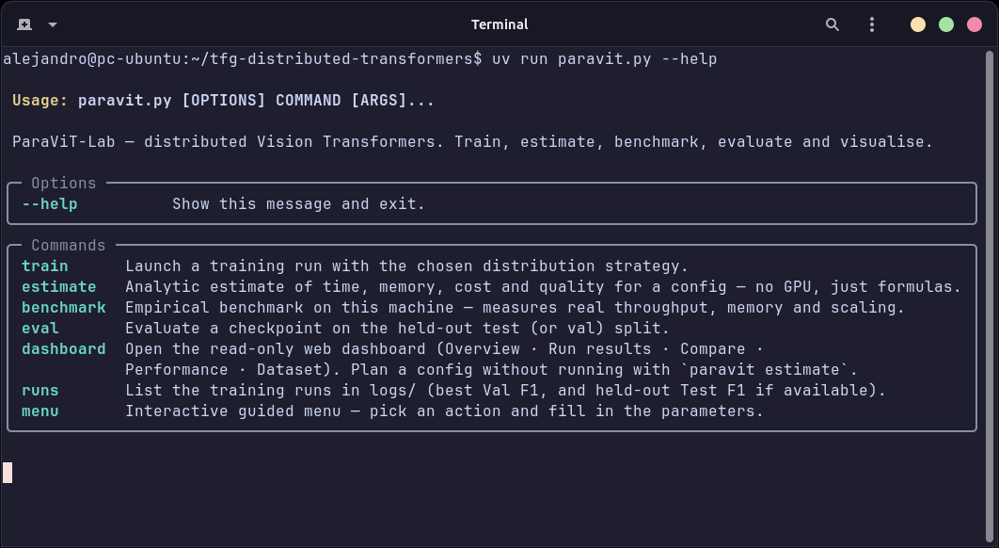
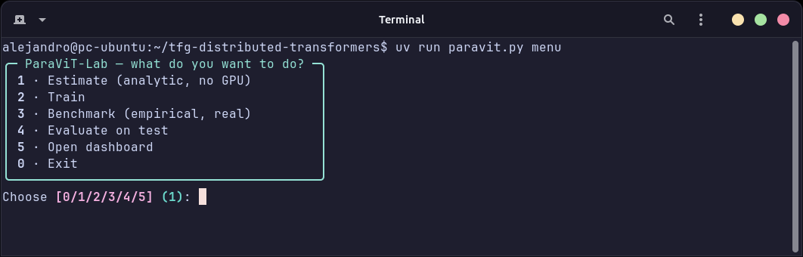
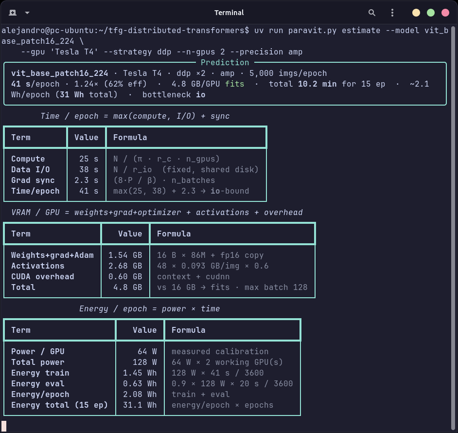
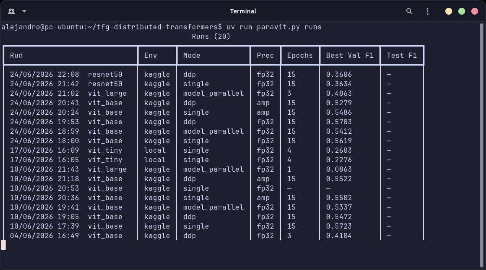
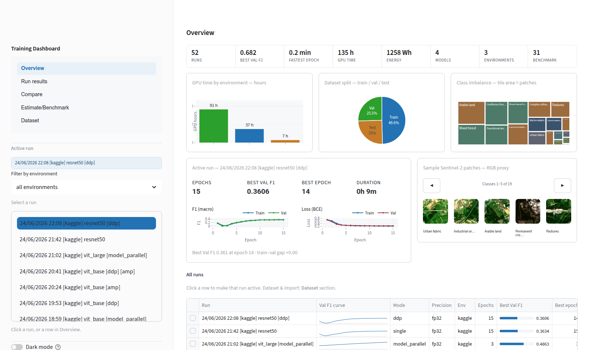
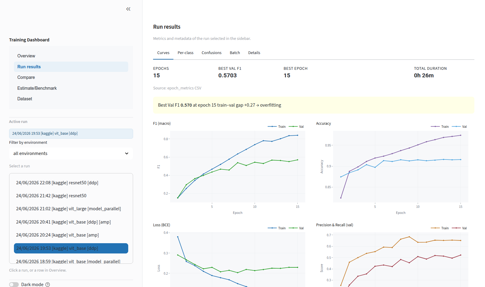
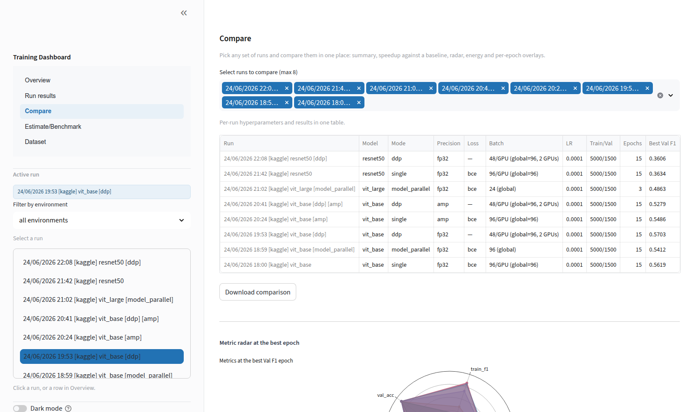
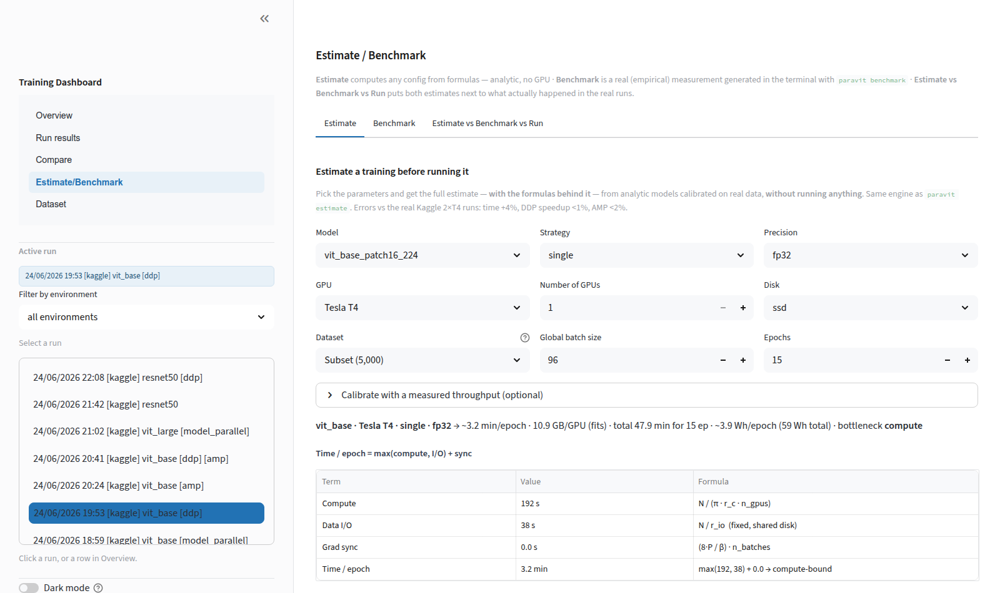

# ParaViT-Lab — Guía de uso

Manual de referencia del sistema por línea de órdenes. Complementa a la guía con capturas de la
memoria del TFG: aquí el foco son los comandos, las configuraciones y la resolución de problemas.

Índice:

1. [Instalación](#1-instalación)
2. [El conjunto de datos (opcional)](#2-el-conjunto-de-datos-opcional)
3. [El CLI `paravit`](#3-el-cli-paravit)
4. [Los ficheros de configuración](#4-los-ficheros-de-configuración)
5. [Las cuatro estrategias de entrenamiento](#5-las-cuatro-estrategias-de-entrenamiento)
6. [Artefactos: qué produce un entrenamiento](#6-artefactos-qué-produce-un-entrenamiento)
7. [El panel web](#7-el-panel-web)
8. [Un flujo de trabajo completo](#8-un-flujo-de-trabajo-completo)
9. [Las pruebas](#9-las-pruebas)
10. [Solución de problemas](#10-solución-de-problemas)

---

## 1. Instalación

Requisitos: `git` y [`uv`](https://docs.astral.sh/uv/) (instala la versión de Python necesaria de
forma automática).

```bash
# Instalar uv si no está presente (Linux/macOS)
curl -LsSf https://astral.sh/uv/install.sh | sh

git clone https://github.com/alerguezrojas/tfg-distributed-transformers.git
cd tfg-distributed-transformers
uv sync
```

No hace falta GPU ni dataset para explorar el proyecto: el estimador analítico calcula con fórmulas
y el panel web lee los resultados reales ya incluidos en `logs/`. La GPU (NVIDIA) solo es necesaria
para entrenar o ejecutar el benchmark, y el dataset solo para entrenar o evaluar.

> **Nota (GPU con driver antiguo):** `uv sync` instala la build de PyTorch más reciente. Si el
> driver de la máquina no la soporta (por ejemplo CUDA 12.0 con driver 525), reinstalar con la
> variante adecuada: `uv pip install torch torchvision --index-url
> https://download.pytorch.org/whl/cu118 --force-reinstall`.

## 2. El conjunto de datos (opcional)

BigEarthNet-S2 v2.0 (549 488 recortes de Sentinel-2, 19 clases multietiqueta) se publica en Zenodo.
Descarga y extracción (63 GB comprimido, ~120 GB extraído; requiere `zstd`):

```bash
wget -c "https://zenodo.org/records/10891137/files/BigEarthNet-S2.tar.zst?download=1" \
     -O BigEarthNet-S2.tar.zst
wget -c "https://zenodo.org/records/10891137/files/metadata.parquet?download=1" \
     -O metadata.parquet
tar --use-compress-program=zstd -xf BigEarthNet-S2.tar.zst
```

Después, apuntar las claves `data.root` (directorio extraído) y `data.metadata` (el
`metadata.parquet`) del fichero de configuración que se vaya a usar.

Para trabajar en plataformas con límite de almacenamiento (Kaggle admite 20 GB por dataset),
`scripts/export_kaggle_subset.py` exporta un subconjunto autocontenido y reproducible (5 000
imágenes de entrenamiento y 1 500 de validación, semilla fija).

## 3. El CLI `paravit`

Punto de entrada único: `uv run paravit.py <comando>` (el antiguo `tfg.py` sigue funcionando como
alias). `--help` funciona en cada subcomando.



| Comando | Qué hace | ¿Necesita GPU? |
|---|---|---|
| `menu` | Menú interactivo: pregunta la acción y los parámetros paso a paso | — |


| `estimate` | Predicción **analítica** de tiempo, memoria, energía, coste y F1 (solo fórmulas) | No |
| `benchmark` | Medición **empírica** en la máquina: throughput real, VRAM, I/O, escalado DDP | Sí |
| `train` | Entrenamiento con la estrategia elegida | Sí |
| `eval` | Evaluación de un checkpoint sobre el split de test (o val) | Sí |
| `runs` | Tabla de todos los entrenamientos registrados con su mejor F1 | No |
| `report` | Informe HTML autocontenido de un run (métricas con IC, calibración, TRIPOD+AI) | No |
| `dashboard` | Abre el panel web en `http://localhost:8501` | No |

### `estimate` — predecir sin entrenar

```bash
uv run paravit.py estimate --model vit_base_patch16_224 --gpu "Tesla T4" \
    --strategy ddp --n-gpus 2 --precision amp
```

Devuelve el titular (s/época, aceleración, VRAM, energía, cuello de botella) y las tablas con las
fórmulas de tiempo `max(cómputo, I/O) + sincronización`, memoria, energía, calidad esperada,
escalado de 1 a 8 GPU y coste en proveedores de nube. Estrategias: `single`, `ddp`,
`model-parallel`, `heterogeneous`. La derivación completa del modelo está en
[`docs/performance_model.md`](performance_model.md).

`--model` acepta cualquier modelo de timm. Los seis de la tabla del predictor están calibrados;
el resto se perfila automáticamente (parámetros y FLOPs medidos sin GPU) y su memoria de
activaciones se estima por regla, sin calibrar, lo que se indica en la salida. Para esos modelos
se pueden ajustar `--in-chans`, `--num-classes` e `--img-size`.



### `benchmark` — medir la máquina real

```bash
uv run paravit.py benchmark --batch-sizes 32,64 --epochs 15
uv run paravit.py benchmark --model resnet50 --batch-sizes 32,64
```

Usa datos sintéticos (no necesita el dataset para medir) y genera un informe de texto y un CSV en
`logs/<entorno>/benchmark/`, que el panel web muestra en *Estimate/Benchmark → Benchmark*. Con
`--convergence-study` añade un estudio de convergencia con datos reales (requiere el dataset).

Con `--config` usa el dataset (`data.name`) y la resolución (`model.img_size`) de esa config. Los
tiempos por época usan el tamaño de sus splits, leído de la partición del dataset; si no está en
disco, se indican con `--train-size` y `--val-size`. El perfil de I/O de parches `*.tif` y la
predicción empírica de F1 solo existen para BigEarthNet: con otro dataset el informe dice que no
hay prior calibrado.

### `train` — entrenar

```bash
# Una GPU, config por defecto
uv run paravit.py train --strategy single --config configs/train.yaml

# Con precisión mixta e instrumentación (decoradores)
uv run paravit.py train --strategy single --config configs/train.yaml \
    --precision amp --layers confusion,batch-monitor --fn energy,timing

# Ver el comando final sin ejecutarlo (útil para copiarlo en una máquina remota)
uv run paravit.py train --strategy ddp --config configs/train_demo_ddp.yaml --dry-run
```

Opciones principales:

| Opción | Valores | Efecto |
|---|---|---|
| `--strategy` | `single` · `ddp` · `model-parallel` · `heterogeneous` | Estrategia de distribución; las distribuidas se lanzan solas con `torchrun` |
| `--config` | fichero YAML | Rutas, modelo, lote, épocas, regularización (sección 4) |
| `--model` | id de timm | Sustituye el modelo del config (`vit_tiny_patch16_224`, `resnet50`…) |
| `--epochs` | entero | Sustituye el número de épocas; si queda `epochs <= warmup_epochs`, baja `warmup_epochs` a `epochs - 1` (mínimo 0) y avisa |
| `--seed` | entero | Sustituye `training.seed` (repeticiones con distinta semilla) |
| `--data-root` | ruta | Sustituye `data.root` (dónde está el dataset en esta máquina). Solo esa clave: las rutas absolutas de `data.metadata` (BigEarthNet) o `data.splits`/`data.mosaics` (PANDA) se cambian en el YAML |
| `--precision` | `fp32` · `tf32` · `amp` · `bf16` | fp32 usa núcleos CUDA; el resto, núcleos tensoriales |
| `--trace` | `off` · `simple` · `deep` | Solo consola / registro a fichero / traza profunda por capas |
| `--layers` | `plot,confusion,batch-monitor,hooks` | Decoradores de aspecto, combinables por comas |
| `--fn` | `timing,energy` | Cronometraje por fase y energía de todas las GPU del run |
| `--monitor` | | Monitor de predicciones: en cada época guarda qué predice el modelo para un subconjunto fijo de validación (con miniaturas), su pérdida por imagen, *embeddings*, mapas Grad-CAM y estadísticas por capa ([detalle](inspeccion.md)). No cambia el entrenamiento |
| (config) `monitor.alerts` | | Alertas en el flujo de eventos (NaN, divergencia, sobreajuste, gradientes, cuello de I/O, GPU al límite); activas por defecto, `monitor.alerts.enabled: false` las apaga y cada umbral se ajusta ([detalle](inspeccion.md#alertas)) |
| `--n-gpus`, `--nnodes`, `--node-rank`, `--master-addr`, `--master-port` | | Coordinación multi-GPU y multi-nodo |
| `--dry-run` | | Imprime el comando final sin ejecutarlo |

Los scripts de `scripts/` (`train_single_gpu.py`, `train_ddp.py`, `train_model_parallel.py`,
`train_heterogeneous_ddp.py`) pueden ejecutarse también directamente; aceptan además `--metrics`
(reporteros individuales de métricas) y `--inspect` (inspección modular del modelo:
`model-summary`, `batch-table`, `grad-monitor`, `anomalies`).



### `eval` — el número honesto final

```bash
uv run paravit.py eval --checkpoint checkpoints/verode/single/vit_base_patch16_224/19112026_101500 --split test
```

`--checkpoint` acepta un fichero (`best.pt`, `last.pt` o un `checkpoint_epoch_NNN.pt` antiguo) o la carpeta
de un run, que se resuelve a su `best.pt`. `--data-root RUTA` sustituye `data.root` del config (igual
que en `train`: solo esa clave), útil para evaluar en otra máquina donde el dataset está en otro sitio.

**Modelo.** Los checkpoints nuevos guardan el modelo con el que se entrenaron (`model_name`), así que
`eval` lo usa sin necesidad de `--model`, aunque el run se lanzase con `--model` distinto al del config.
Si se pasa `--model` y contradice al checkpoint, o un conjunto mezcla modelos, falla antes de cargar.
Los checkpoints antiguos (sin esa clave) siguen usando el modelo del config o `--model`.

**Conjunto de checkpoints.** Repetir `--checkpoint` evalúa un *ensemble*: se infiere el mismo split
con cada modelo (cargados de uno en uno, para no acumular memoria), se **promedian las
probabilidades** y todo lo demás (métricas, umbral, grupos, cortes clínicos, CSV) se calcula sobre
ese promedio con el mismo código. Todos deben dar la misma forma de salida y los mismos objetivos;
si no, falla con un error claro.

```bash
uv run paravit.py eval --config configs/train_panda.yaml \
    --checkpoint RUN_S42/best.pt --checkpoint RUN_S43/best.pt --checkpoint RUN_S44/best.pt \
    --save-predictions logs/local/panda/ensemble_preds.npz
```

El log abre con una línea `Conjunto   : N checkpoints (...)` y otra `Epochs     : ...`; el resto del
formato no cambia. La pérdida es la media de las de los miembros; con `--threshold-from checkpoint`
el umbral es la media de los guardados en los miembros (si falta alguno, se ajusta en validación).
`--save-predictions` **exige ruta explícita** con un conjunto (no hay un único run del que deducir el
sello); con un solo checkpoint no cambia nada.

Evalúa una única vez sobre el split de test y escribe un `test_*.csv` (métricas por clase + fila
agregada, con el AUC macro) que el panel web muestra en la tarjeta «Held-out test set» del run.

Tras las métricas agregadas y por clase, `eval` añade (solo si procede):

- **Métricas por grupo** (`── Metrics by group: <variable> ──`): si el dataset expone `groups()`
  (PANDA: el centro, `data_provider`), `n`, exactitud, F1 macro, AUC macro y QWK (si es ordinal)
  de cada valor.
- **Cortes clínicos** (`── Clinical cut-offs ──`): en tareas ordinales, sensibilidad, especificidad,
  VPP, VPN y AUC de «grado ≥ k» para cada k (puntuación `P(grado ≥ k)`, regla `argmax ≥ k`). En
  PANDA, `≥ ISUP 1` es «hay cáncer» y `≥ ISUP 2` «cáncer clínicamente significativo».
- `--save-predictions RUTA.npz` guarda probabilidades, objetivos, umbral, clases, tarea y grupos
  por muestra para rehacer análisis sin reinferir (formato en [`inspeccion.md`](inspeccion.md)).
  Sin ruta (`scripts/eval.py --save-predictions`; en `paravit.py`, `--save-predictions-auto`) lo
  guarda en la carpeta de logs del run como `test_preds_<ts>.npz`, con el sello del run, y el
  Inspector de la web lo ofrece como fuente «Test (eval)».

En tareas con umbral (multi-etiqueta y binaria), el F1 "con umbral" usa el umbral **elegido en
validación** durante el entrenamiento, que va guardado en el checkpoint. Con checkpoints antiguos
que no lo guardan, se ajusta antes sobre el split de validación. `--threshold-from test` reproduce
el comportamiento anterior (ajustarlo sobre el propio test), que da una cifra optimista.

### `compare-preds` — comparar dos grupos de runs

Con tres semillas por variante, la diferencia entre medias casi siempre cae dentro del ruido. Este
comando decide con las predicciones guardadas (`eval --save-predictions`): no usa GPU ni torch.

```bash
uv run paravit.py compare-preds \
    --a RUN_A_S42/test_preds.npz --a RUN_A_S43/test_preds.npz --a RUN_A_S44/test_preds.npz \
    --b RUN_B_S42/test_preds.npz --b RUN_B_S43/test_preds.npz --b RUN_B_S44/test_preds.npz \
    --label-a Variante --label-b Base --group data_provider --markdown
```

(`scripts/compare_predictions.py --a f1 f2 f3 --b g1 g2 g3` admite también la lista seguida.) Todos
los ficheros deben ser del mismo test y del mismo orden; si no, falla con un error claro. Hoy solo
admite tareas multiclase (con QWK y exactitud ±1 si son ordinales). Imprime:

- las métricas de cada run (QWK, exactitud, ±1 grado, AUC de «clase ≥ 1» con la puntuación
  1 − p(clase 0)) y la métrica principal por subgrupo (`--group`);
- la media ± desviación (ddof = 1) de cada grupo y su conjunto (media de probabilidades);
- el *bootstrap* emparejado A − B (`--n-boot`, por defecto 2000; `--seed`, por defecto 0; los
  mismos índices de remuestreo para todos los runs): media de las semillas, conjunto y, si los
  grupos tienen el mismo tamaño, cada pareja (la i-ésima de A con la i-ésima de B). IC 95 % por
  percentiles y P(d ≤ 0).

Con `--markdown` salen tablas con coma decimal, listas para pegar en `docs/datasets/*.md`.

### `select-ensemble` — elegir un conjunto en validación

Para combinar varios runs (arquitecturas y semillas) sin mirar el test al decidir. La elección usa
**solo validación**; el conjunto elegido se evalúa una única vez en test. Parte de las
predicciones guardadas de cada run (`eval --split val --save-predictions` y
`eval --split test --save-predictions`, guardadas como `val_preds.npz` y `test_preds.npz` en la
carpeta del run). No usa GPU ni torch.

```bash
uv run paravit.py select-ensemble \
    --runs RUN_VIT_S42 RUN_VIT_S43 RUN_SWIN_S42 RUN_DEIT_S42 \
    --group 'RUN_VIT_*=vit_s' --method per-group \
    --reference RUN_VIT_S42 RUN_VIT_S43 RUN_VIT_S44 --markdown
```

`--group PATRÓN=GRUPO` (se repite) asigna a un grupo, por ejemplo su arquitectura, los runs cuya
carpeta encaja con el patrón (comodines de la *shell*: `'panda_m_swin_t*=swin_t'`); gana el primer
patrón que encaja y un run sin patrón es su propio grupo. Los grupos se dan en la línea de
comandos y no en un fichero: la herramienta no lee nada más que las predicciones. Hay dos métodos:

- `per-group` (por defecto): el mejor run de cada grupo según validación, ordenados de mejor a peor;
  se evalúa en validación el conjunto de los k primeros (k = 1…) y se elige el k de máxima
  validación (a igualdad, el menor).
- `greedy`: selección hacia delante de Caruana et al. (2004). En cada paso se añade el run (con
  repetición, que equivale a darle más peso) que más sube la métrica del promedio de
  probabilidades en validación; termina al no mejorar o al llegar a `--max-size` (8).

El conjunto es siempre la media de probabilidades. La salida trae la tabla de candidatos (métrica
principal en validación y en test), la traza de la selección (solo validación) y la evaluación
única en test con todas las métricas de `compare-preds`. Con `--reference` (carpetas del conjunto
de referencia, p. ej. tres semillas de la base) añade la diferencia elegido − referencia con IC 95 %
por *bootstrap* emparejado (`--n-boot`, `--seed`). Los ficheros deben ser del mismo split y del
mismo orden en todos los runs (error claro si no), y solo se admiten tareas multiclase.

Aviso: elegir el conjunto mirando el test (por ejemplo, probar combinaciones y quedarse con la
mejor en test) sesga el resultado al alza: el test deja de ser una estimación honesta. Si se
repite la elección con otro criterio, hay que documentarlo; la cifra de test se da una sola vez.

### `report` — informe de un run

```bash
uv run paravit.py report 25102026_120000                 # por sello (se busca bajo logs/)
uv run paravit.py report logs/local/medmnist_derma/single/vit_tiny_patch16_224   # carpeta del run
uv run paravit.py report logs/.../events_25102026_120000.jsonl --epoch 12 --n-boot 2000 -o informe.html
```

Genera **un solo fichero HTML** (plotly.js embebido una vez, imágenes en base64, sin recursos
externos), que se puede enviar por correo. Por defecto queda en `report_<sello>.html` junto al
`events_*.jsonl` (los `report_*.html` no se versionan). Solo lee `logs/`: no usa GPU ni entrena.
Secciones: resumen (dataset, tarea, modelo, entorno con UUID de GPU, energía aproximada,
configuración plegable), entrenamiento (curvas, rendimiento, GPU, alertas), evaluación de la
época elegida (`--epoch`, por defecto la última inspeccionada: métricas con IC95 *bootstrap* con
semilla anotada, ROC/PR, tabla por clase, matriz de confusión, calibración con pendiente e
intercepto, puntos de operación, peores errores y Grad-CAM), dinámica (cartografía y PCA) y la
lista **TRIPOD+AI** (Collins et al., BMJ 2024, [doi:10.1136/bmj-2023-078378](https://doi.org/10.1136/bmj-2023-078378)),
con cada ítem como *documentado*, *parcial* o *pendiente* (lo que exige a los autores no se marca).
Sin `inspect_<sello>/` o sin eventos `system`, la sección lo dice e indica qué activar
(`--monitor`, `monitor.system_interval_s`). La evaluación usa la validación: no sustituye a `eval`
sobre test.

## 4. Los ficheros de configuración

Estructura de un config (YAML):

```yaml
data:
  name: bigearthnet                     # dataset registrado (opcional; por defecto bigearthnet)
  root: "/ruta/al/BigEarthNet-S2"      # directorio del dataset
  metadata: "/ruta/al/metadata.parquet"
  num_workers: 4
model:
  name: "vit_base_patch16_224"          # cualquier id de timm
  pretrained: true
  num_classes: 19                       # opcional: sale del dataset (si se pone, debe coincidir)
  dropout: 0.3
  img_size: 512                         # opcional: lado de entrada del ViT (por defecto 224)
training:
  epochs: 30
  batch_size: 64                        # por GPU en DDP
  lr: 0.0001                            # ojo: no escribir 1e-4 (YAML lo lee como texto)
  weight_decay: 0.1
  warmup_epochs: 5
  llrd_decay: 0.75                      # learning rate por capas (cualquier modelo de timm)
  grad_clip: 1.0
  early_stopping_patience: 10
  select_by: f1                         # mejor checkpoint: f1 | f1_optimal | auc | qwk
  label_smoothing: 0.1                  # regularización opcional
  mixup_alpha: 0.2
checkpoint:
  dir: "checkpoints/local"
  keep: best_last                       # best_last (defecto: best.pt + last.pt) | all (uno por época mejorada)
output:
  env: "local"                          # local | verode | kaggle → organiza logs/
```

Configs incluidos: `train.yaml` / `train_v3.yaml` (local), `train_cluster*.yaml` (clúster),
`train_demo_single.yaml` / `train_demo_ddp.yaml` (estudio comparable sobre el subconjunto),
`train_model_parallel_kaggle.yaml`, `train_heterogeneous_ddp*.yaml` y la pareja
`train_cluster_focal.yaml` / `train_cluster_bce.yaml` (pérdidas para clases raras).

`model.img_size` construye el *backbone* de timm para otro tamaño de entrada (timm adapta los
*position embeddings* preentrenados); el dataset debe entregar imágenes de ese lado. `select_by: qwk`
(kappa cuadrático ponderado, columna `val_qwk` del CSV) solo vale para datasets con clases
ordenadas (`ordinal=True` en su ficha, p. ej. un grado de cáncer).

Las claves de `data:` dependen del dataset elegido con `data.name`. Los datasets disponibles y
cómo añadir uno nuevo están en [`datasets/README.md`](datasets/README.md).

## 5. Las cuatro estrategias de entrenamiento

**Una GPU (`single`).** El caso base. Incluye LLRD, calentamiento, decaimiento coseno, parada
temprana y las regularizaciones del config.

**Paralelismo de datos (`ddp`).** Réplica del modelo en cada GPU y sincronización de gradientes
(NCCL). Escala casi linealmente cuando el cuello es el cómputo (1,99× medido con 2 GPU). El lote del
config es **por GPU**. Con varios nodos, ejecutar el mismo comando en cada uno cambiando
`--node-rank` (el nodo 0 es `--master-addr`):

```bash
uv run paravit.py train --strategy ddp --config configs/train_ddp_verode.yaml \
    --nnodes 2 --node-rank 0 --master-addr nodo0 --n-gpus 1
```

**Paralelismo de modelo (`model-parallel`).** Parte el ViT en dos etapas, una por GPU
(`--split-block` en el script elige el punto de corte). No acelera (etapas en serie), pero permite
entrenar modelos que no entran en una sola GPU: vit_large (303 M parámetros) desborda una T4 y
entrena partido entre dos.

**Heterogéneo (`heterogeneous`).** GPU + CPU con reparto proporcional a la velocidad de cada
dispositivo (backend gloo) y normalización del gradiente por el lote global. Documenta el caso de
hardware desigual: el entrenamiento síncrono avanza al ritmo del dispositivo más lento (0,12×
medido), así que solo compensa distribuir entre dispositivos comparables.

## 6. Artefactos: qué produce un entrenamiento

Cada run escribe, bajo `logs/<entorno>/<estrategia>/<modelo>/`:

| Fichero | Contenido |
|---|---|
| `train_<fecha>.log` | Registro completo (config del run, época a época, energía, tiempos) |
| `epoch_metrics_*.csv` | Métricas por época (F1, pérdida, exactitud, tiempos…) |
| `perclass_metrics_*.csv` | Precisión/exhaustividad/F1 de cada clase por época |
| `confusion_matrix_*.csv` | Matriz de co-activación 19×19 por época |
| `batch_metrics_*.csv` | Pérdida, F1 y learning rate por lote |
| `run_<fecha>.json` | Manifiesto del run (dataset, tarea, métrica principal, config completa y comando; unos KB, se versiona): lo que lee la web para saber de qué va el run ([esquema](eventos.md#manifiesto-del-run-run_ddmmyyyy_hhmmssjson)) |
| `events_*.jsonl` | Flujo de eventos del run ([esquema](eventos.md)): lo que lee la pestaña *Live* |
| `inspect_<fecha>/` | Con `--monitor`: predicciones por imagen, *embeddings* y Grad-CAM por época ([formato](inspeccion.md)); no se versiona |
| `test_*.csv` | Resultado de la evaluación en test (si se ejecutó `eval`) |
| `test_preds_<fecha>.npz` | Predicciones por muestra en test (`eval --save-predictions`); el Inspector las lee |

Los pesos van a `checkpoints/<env>/[<dataset>/]<modo>/<modelo>/<DDMMYYYY_HHMMSS>/` (fuera de git): una
carpeta por run, con el mismo sello que sus logs. Por defecto solo se conservan `best.pt` (mejor época
según `select_by`) y `last.pt` (última época, para reanudar con `--resume`, que también acepta la
carpeta del run); con `checkpoint.keep: all` se guarda un `checkpoint_epoch_NNN.pt` por época que
mejora. Los ficheros se escriben a un temporal y se renombran, así que un disco lleno no deja un
`best.pt` corrupto. Los checkpoints antiguos siguen sirviendo con `--checkpoint RUTA`.

Cada run deja dos ficheros (~0,5 GB con ViT-S) y los runs se acumulan: **hay que borrar a mano los
viejos**; esto evita mezclar runs, no libera disco por sí solo. `last.pt` guarda además la época
global (las reanudaciones encadenan), el estado del `GradScaler` (AMP), la mejor métrica y el
contador de *early stopping*, que `--resume` restaura. **No se restauran** el estado de los
generadores aleatorios ni el orden de los lotes (la reanudación no es bit a bit idéntica), y el
`best.pt` del run reanudado solo aparece si mejora la mejor métrica anterior (el anterior sigue en
la carpeta del run original). Si escribir `last.pt` falla (disco lleno) se avisa y el
entrenamiento continúa; si falla `best.pt`, el run aborta. El panel web descubre los runs automáticamente; los
entrenados en otra máquina se importan desde la sección *Dataset → Import* subiendo un zip de esos
ficheros.

## 7. El panel web

```bash
uv run paravit.py dashboard    # → http://localhost:8501
```

Interfaz de solo lectura (el terminal ejecuta, la web analiza), con siete secciones: **Overview**
(indicadores globales, run activo, tabla de runs), **Live** (seguimiento de un entrenamiento en
curso, ver más abajo), **Inspector** (análisis a fondo de un run, ver más abajo), **Run results** (curvas, métricas por clase,
confusiones, lotes y detalles del run activo), **Compare** (hasta 12 runs de un mismo dataset:
aceleración frente a una referencia, radar, energía, curvas superpuestas), **Estimate/Benchmark** (el estimador analítico, los
informes del benchmark y la comparación estimación-vs-benchmark-vs-real) y **Dataset** (composición
del conjunto e importación de runs). Idioma inglés con vista opcional en español y modo oscuro.

**La web conoce el dataset y la métrica de cada run.** Los metadatos salen del manifiesto del run
(`run_*.json`), de los eventos o de la línea `Configuración:` del log, por ese orden
([detalle](eventos.md#manifiesto-del-run-run_ddmmyyyy_hhmmssjson)). Con ellos:

- **Etiqueta del run:** además de fecha, entorno, dataset, modelo y precisión, añade solo lo que
  no es el valor por defecto: `· ce_emd · seed 43 · train: karolinska · color 0.2 · 512px`
  (pérdida, semilla distinta de 42, hospital, aumentos de color, resolución distinta de 224). Así
  dos runs se distinguen en la barra lateral, en las tablas y en *Compare*.
- **Métrica principal por run** (la de `select_by`; si falta, la del dataset): **QWK** en PANDA,
  **AUC** en MedMNIST y **F1** en BigEarthNet. Overview, Run results y Compare usan su nombre y
  su valor, dibujan su curva (también `val_qwk`) y rotulan la pérdida real (BCE, CE, CE + EMD).
  Los indicadores del Overview (mejor resultado, época más rápida) son del dataset del filtro
  lateral o, si es «All», del run activo, y nunca mezclan F1 con QWK. Si el CSV de un run antiguo
  no tiene la columna (p. ej. `val_auc`), se usa F1.
- **Paneles por dataset:** solo se muestran los del dataset en curso. BigEarthNet conserva los
  suyos (reparto, desequilibrio de clases, un parche por clase). Los demás tienen una vista
  genérica con lo que hay en `logs/`: tarea, clases (y si son ordenadas), tamaños de train y val
  del run, hospitales (`data.providers`), la distribución de clases de la validación y miniaturas
  del panel fijo del monitor (ambas salen de `inspect_<fecha>/`; si el run no lo tiene, la web lo
  dice y no inventa nada).
- **Compare** trabaja con un dataset cada vez (selector arriba) y **agrupa los runs que solo
  difieren en la semilla**: una fila por configuración con *media ± desviación típica muestral*
  de la métrica principal, la época del mejor valor, el valor final, el AUC y las épocas; las
  curvas por época se dibujan como media con una banda de ±1 desviación (con las épocas a las que
  llegan menos runs por parada temprana, cada punto promedia los runs que llegaron). El
  interruptor «Aggregate runs that differ only in the seed» las desactiva. Dos runs son «solo
  semilla distinta» si coinciden en dataset, modelo, estrategia, entorno, pérdida, hospitales,
  color, resolución, lote, lr, épocas y precisión; un run que no registra su semilla nunca se
  agrupa. La tabla pone la métrica justo después del nombre del run y añade columnas de semillas,
  hospitales, color y resolución; el radar usa las métricas que registraron los runs.

### Seguir un entrenamiento en directo (Live)

Mientras un run entrena, el proceso principal añade eventos a
`logs/<entorno>/…/events_<DDMMYYYY_HHMMSS>.jsonl`, junto al `train_*.log` del mismo run. La sección
**Live** los lee de forma incremental (solo lo nuevo en cada vuelta) y muestra:

- **Estado**: *Running*, *Completed*, *Early stopped*, *Failed* o *Stalled* (el run no ha terminado
  pero el fichero lleva más de N minutos sin cambios; por defecto 10, configurable en la propia
  sección), con el dataset, el modelo y la estrategia.
- **Progreso y ETA**: épocas hechas frente a las planificadas. El ETA es la media del tiempo de
  época por las épocas que faltan, así que es una cota superior si hay *early stopping*.
- **Indicadores**: épocas hechas, mejor valor de la métrica de selección y la última loss, F1 y AUC
  de validación (con su variación respecto a la época anterior).
- **Curvas**: loss de train y validación, F1 y AUC de validación por época y, si el entrenamiento
  registra batches, la loss por batch.
- **Configuración y entorno** del run (versiones, equipo, dispositivos) en un desplegable.

Se elige el run en la lista (por defecto, el activo más reciente), el interruptor **Live** activa o
pausa el refresco automático y **Refresh every** fija el intervalo (2, 5, 10 o 30 s). Solo se vuelve
a pintar el contenido de la sección, no el resto de la página. Si se lanza un entrenamiento con la
sección ya abierta, pulsar **Refresh now** para que aparezca en la lista. La web no entrena ni
toca la GPU: solo lee el fichero.

### Analizar un run a fondo (Inspector)

**Inspector** abre un run con flujo de eventos y/o directorio `inspect_<ts>/` (se generan con
`--monitor`, ver [inspeccion.md](inspeccion.md)) y sirve tanto en vivo (mismo refresco que Live)
como a posteriori. Un selector elige la vista; las vistas por época usan un deslizador de época
(por defecto sigue la última):

- **System**: utilización, memoria, potencia, temperatura y reloj por GPU; CPU y RAM del proceso;
  medias, picos y energía aproximada (integral de la potencia muestreada).
- **Performance**: muestras/s, tiempo de paso y espera del DataLoader. Más de un 30 % del tiempo
  esperando datos se diagnostica como cuello de I/O.
- **Predictions**: galería de miniaturas con borde verde (acierto) o rojo (fallo), filtros por
  clase real y predicha, acierto, cambio respecto a la época anterior y orden por pérdida o
  confianza; al elegir una muestra, su trayectoria por época y su Grad-CAM.
- **Errors**: peores errores, matriz de confusión (conteos o normalizada) con las imágenes de la
  celda elegida, y TP/FP/FN por clase.
- **Curves**: ROC y PR por clase con macro y micro, F1/sensibilidad/especificidad frente al umbral,
  tabla por clase y evolución del AUC y AP macro. Las métricas macro (y, si se pide, las de cada clase) llevan
  intervalos de confianza *bootstrap* al 95 % con 200, 1000 o 2000 remuestras. Usa las probabilidades de toda la validación si
  el run las guardó; si no, las del subconjunto (y lo indica).
- **Clinical**: punto de operación de una clase (uno contra el resto en multiclase): umbral manual, el óptimo de
  validación del run, sensibilidad objetivo (0,90 / 0,95…) o Youden; sensibilidad, especificidad, VPP, VPN, F1 y
  matriz 2×2 con intervalos de confianza, prevalencia editable para VPP/VPN y ROC con el punto marcado.
- **Calibration**: diagrama de fiabilidad, histograma de confianza, ECE/MCE/Brier, pendiente e intercepto de
  calibración (pendiente < 1 = sobreconfianza), ECE adaptativa y por clase, y su evolución por época.
- **Subgroups**: solo aparece si el run tiene `groups.npz` (ver [inspeccion.md](inspeccion.md)); métricas por
  grupo con intervalos y la brecha entre el mejor y el peor.
- **Dynamics**: cartografía de datos (fácil, ambigua, difícil) y cambios de acierto entre épocas;
  las muestras «difíciles» son candidatas a etiqueta errónea.
- **Embeddings**: proyección 2D (PCA, o UMAP si está instalado) coloreada por clase o acierto.
- **Explain**: panel de Grad-CAM superpuesto (opacidad ajustable) y su evolución por época.
- **Layers**: mapas de calor por grupo de capas de la norma del gradiente, la norma de los pesos y
  el ratio de actualización (banda sana 1e-4 a 1e-2), e histogramas de pesos (o de gradientes, si el run los
  trae) por época.
- **Alerts**: lista cronológica de las alertas de salud del entrenamiento (NaN, divergencia, sobreajuste,
  gradientes, cuello de I/O, GPU). Las activas salen como banner (rojo = crítica, ámbar = aviso) en la
  cabecera del Inspector y de Live.

Si el run tiene `test_preds_<ts>.npz` (de `eval --save-predictions`), arriba aparece un selector de
fuente, «Validation (monitor)» o «Test (eval)». En test funcionan *Curves*, *Clinical*,
*Calibration* y *Subgroups* sobre las predicciones de la evaluación; en tareas ordinales, *Clinical*
añade la tabla de cortes «grado ≥ k».

Cada vista indica cómo activar los datos que le faltan (`--monitor`, `monitor.layers: true`…). Solo
se calcula la vista elegida y los `.npz` se cachean por ruta y fecha de modificación.









## 8. Un flujo de trabajo completo

Las dos interfaces se complementan: el terminal ejecuta y la web analiza. El flujo seguido en los
experimentos del TFG es el siguiente.

1. **Estimar.** Antes de gastar tiempo de GPU, `paravit estimate` predice el tiempo, la memoria, la
   energía y el coste de la configuración prevista, y avisa si el modelo no entra en la GPU elegida.
2. **Medir la máquina.** `paravit benchmark` comprueba sobre el equipo real el rendimiento, el estado
   del disco y el escalado esperado del paralelismo de datos.
3. **Entrenar.** `paravit train` lanza el entrenamiento con la estrategia y la instrumentación
   elegidas. En una máquina remota, `--dry-run` proporciona el comando exacto que hay que ejecutar.
4. **Analizar.** Los artefactos del entrenamiento se importan en el cuadro de mandos si vienen de otra
   máquina, y las secciones Run results, Compare y Estimate/Benchmark permiten estudiar el run,
   compararlo con los demás y contrastar lo predicho con lo medido.

## 9. Las pruebas

```bash
uv run pytest            # más de 1.200 pruebas, también ejecutadas en CI en cada push
```

## 10. Solución de problemas

| Síntoma | Causa | Solución |
|---|---|---|
| `lr '<=' not supported between float and str` | `1e-4` en YAML se lee como texto | Escribir `0.0001` |
| `CUDA not available` con GPU presente | Build de PyTorch más nueva que el driver | Reinstalar con `--index-url .../cu118` (ver sección 1) |
| `CUDA out of memory` | Lote demasiado grande para la VRAM | Reducir `batch_size`; `paravit estimate` predice el lote máximo |
| `Duplicate GPU detected` (NCCL) | Dos procesos DDP en la misma GPU física | NCCL exige 1 proceso = 1 GPU; usar 2 GPU reales o backend gloo |
| `Cannot use ReduceOp.AVG with Gloo` | gloo no implementa la media | Ya mitigado en el código (SUM / world_size); actualizar el repo |
| `Illegal instruction` al importar torch | CPU sin AVX2 (nodos de login antiguos) | Ejecutar en un nodo de cómputo |
| El benchmark estima tiempos muy distintos del run | Subconjunto cacheado en RAM tras la primera época | Esperado en datasets pequeños: el disco deja de ser el límite |
| `[energy] GPU no disponible` | `nvidia-ml-py` no instalado o sin acceso al driver | `uv sync`; el aviso no afecta al entrenamiento |
| La web no muestra un run | Artefactos fuera de `logs/` | Importarlos desde *Dataset → Import* o copiarlos a `logs/` |
